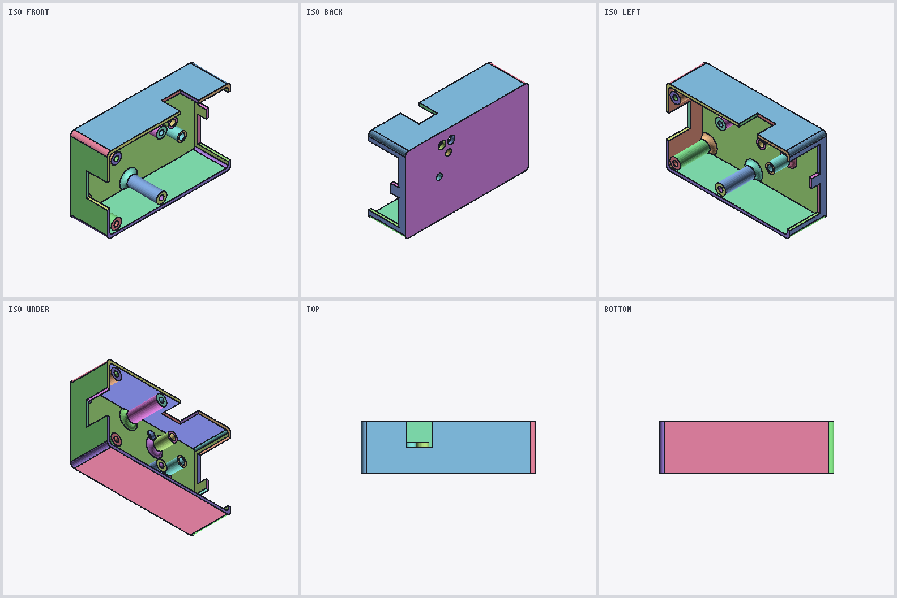
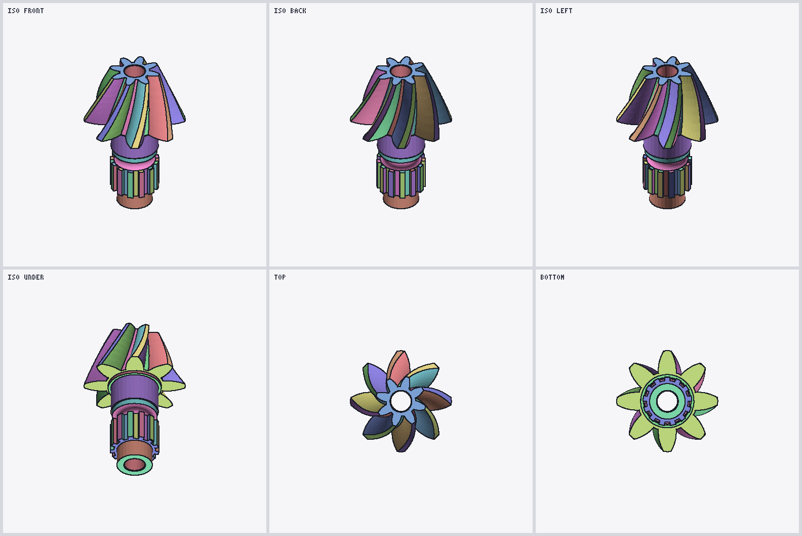

# 2. The display mesh (DisplayLists)

`Contents/DisplayLists` (modern) and `DisplayLists__ZLB` (SolidWorks 2011) hold the triangle mesh
SolidWorks drew the part with. There's one record per B-rep face, followed by a record describing
that face's surface. Both containers and every DisplayLists version in the corpus (13000–17000)
use the same per-face grammar.

All integers are little-endian `u32`. Coordinates are `float32` in **metres**, and surface
parameters are `float64`. The reference reader is [`display.js`][display.js].

From this stream you get the exact display triangles with their normals, which triangle edges lie
on a face boundary and which B-rep edge each one belongs to, an analytic bounding box per face,
and the surface type of each face, with its parameters for planes, cylinders and cones. You don't
get exact curved geometry. The mesh only approximates curved surfaces, so for exact geometry follow
the face ID to the Parasolid body ([page 3](3-parasolid-body.md)).



*USB hub case top: 68 faces read straight from DisplayLists. The black lines are the Block1
boundary edges.*

## Typed arrays

Every array in the record starts with a 16-byte header `[stride, kind, 2, count]`, followed by
`stride × count` bytes. These combinations show up:

| header | element |
|---|---|
| `[4, 8, 2, n]` | u32 |
| `[1, 8, 2, n]` | u8 |
| `[12, 100, 2, n]` | float32 × 3 |
| `[4, 100, 2, n]` | float32 |
| `[8, 100, 2, n]` | 8-byte elements (only in the surface record, kept raw) |

The third word is always `2`. "Kind" and "stride" are just names for what was measured. They
aren't a claim about SolidWorks' own type system.

## Face record

The stream starts with `u32 [1, 1]`. To find face records, scan for the strip-length header
`[4, 8, 2, S]` and read forward. Every check below has to pass, or the candidate gets rejected and
reported. Nothing is patched up.

| order | header | body | name |
|---|---|---|---|
| 1 | `[4, 8, 2, S]` | `u32[S]` = L | strip lengths |
| 2 | `[12, 100, 2, V]` | `float32[V][3]` | positions |
| 3 | `[12, 100, 2, V]` | `float32[V][3]` | normals, unit length |
| 4 | `[4, 8, 2, N]` | `u32[N]` | Block1: edge annotations |
| 5 | `[4, 8, 2, S]` | `u32[S]` | Block2: Block1 section lengths |
| 6 | `[1, 8, 2, N]` | `u8[N]` | Block3 |
| 7 | none | 132 bytes | bounding record |
| 8 | none | variable | surface record (modern only) |

`S` is the number of strips, `L[i]` the vertices in strip `i`, `V` the vertices and `N` the Block1
words. These hold with no exception on 11,515 strips in 45 modern files:

```
V     = sum(L)            every L[i] >= 3
B2[i] = 2·L[i] − 2
N     = sum(B2) = 2·(V − S)
```

**Block2 tells you nothing new.** The strip lengths fully decide it ([EXP-061][exp061]). It's the
table of Block1 section lengths.

**Block3** has one byte per Block1 word. All 122,142 of them in the original corpus are zero. What
it's for is unknown, and the reference reader warns if it ever sees a nonzero byte.

### Triangles

Each strip is an ordinary triangle strip over its own vertices. With vertex base `v` and strip
length `n`:

```
i = 2, 4, 6, …   triangle (v+i−2, v+i−1, v+i)
i = 3, 5, 7, …   triangle (v+i−1, v+i−2, v+i)
```

Reset the base and the winding at every strip. Don't join strips together and don't fan out from
the first vertex. All 50,976 strip triangles in the original corpus agree with the stored normals,
and reading them as fans fails on the controlled models.

A strip is just a unit of the tessellation. A face with a hole can be twelve strips and two
boundary cycles, and Dekor's big faces have 121 boundary cycles each. The strip count isn't a loop
count.

### Block1: which edges are face boundaries

Each strip's section is one control word (`1` on every strip in the modern corpus), then one word
per strip edge, in this order:

```
ID(0,1),
ID(0,2), ID(1,2),
ID(1,3), ID(2,3),
ID(2,4), ID(3,4), …
```

Each new vertex adds two edges, so a strip of `n` vertices has `2n − 3` edges. With the control
word, its section is `2n − 2` words long, which is its Block2 entry.

- `0` means the edge is inside the face (a triangulation diagonal).
- Anything else means the edge is on the face boundary, and **the value is the Parasolid `node_id`
  of the B-rep edge it lies on**. Every nonzero ID in a part is shared by exactly two faces.

Measured: 41,010 boundary annotations are all nonzero and 71,037 interior ones are all zero. If you
shuffle the edge order inside each strip but keep the values, you get 44,640 exceptions, so the
order above really matters ([EXP-049][exp049]). The words are `u32`. Read as `float32`, all 162,018
of them come out below 1e-30.

Use Block2's lengths to split the sections. Don't treat every `1` as a separator, because nothing
says an edge ID can't be 1.



*Helical bevel gear, 113 faces. The gaps between the teeth are real geometry, not missing faces.
All 32 open edges in this mesh run along another open edge, which is the sampling effect described
next.*

### Boundary cycles

Take only the edges with a nonzero ID and join vertices whose coordinates are exactly equal. On
every face in the corpus, that gives a graph where every vertex has two neighbours. Its loops are
the face's boundary cycles (1,698 cycles on 1,272 faces). They're display polylines: the reference
reader doesn't decide which one is the outer boundary, and it doesn't weld vertices.

Two neighbouring faces can sample their shared edge differently. 389 of 3,278 shared edge IDs have
different vertices on the two sides, and they always lie on the same line (the biggest offset
measured is 8.3e-9 m). So welding by exact coordinates leaves some open edges on curved models
even though nothing is missing. The 13 controlled cubes close up under exact matching.

## Bounding record (132 bytes)

Right after Block3, in both containers:

| offset | type | field |
|---|---|---|
| +0 | u32 × 3 | `0, 0, 1` on all 1,414 modern faces. Meaning unknown |
| +12 | float64 × 3 | centre |
| +36 | float64 × 3 | maximum corner |
| +60 | float64 × 3 | minimum corner |
| +84 | float64 | radius: the distance from the centre to a corner |
| +92 | 40 bytes | not decoded |

On every face the centre is exactly halfway between the corners and the radius is exactly the
corner distance (to under 1e-12), and `min ≤ max` on 1,461 of 1,461 modern and 145 of 145 legacy
records.

This is the face's **analytic** box, not the box of its mesh. It contains the mesh and almost never
equals it. Put together over a whole part, the boxes match the STEP geometry to within 1 nm on 23
of the 24 modern controlled models. The odd one out is the spline loft C16, which is padded by
about 10.4 µm on every side, so spline boxes aren't guaranteed to be tight
([EXP-061][exp061], [EXP-063][exp063], [EXP-064][exp064]).

The same layout also turns up once per configuration elsewhere in the stream, after the
configuration's name in UTF-16LE (45 of 45 modern files). Nobody knows yet what that box is for.

## Surface record (modern only)

It starts 132 bytes after Block3, right after the bounding record. Read it forward:

| step | content |
|---|---|
| 1 | typed array `[8, 100, 2, K]`. Empty except on eight distributor faces (K = 50, 54), kept raw |
| 2 | `u32`, `1` everywhere in the corpus |
| 3 | typed array `[12, 100, 2, A]`, empty everywhere in the corpus |
| 4 | typed array `[12, 100, 2, B]`, empty everywhere in the corpus |
| 5 | `u32 scalarFlag`: `0`, or `1` followed by two `[4, 100, 2, V]` float32 arrays with one value per vertex |
| 6 | `u32 × 3`, zero everywhere in the corpus |
| 7 | `u32` **face ID**, which is the Parasolid FACE `node_id` |
| 8 | `float64 × 3` direction |
| 9 | `u32` **surface type tag** |
| 10 | `float64 × 8` parameters |
| 11 | `u32` edge count, then that many `(u32 edge ID, u32 edge type tag)` pairs |

Don't read the tag at a fixed offset. The arrays in steps 1, 3, 4 and 5 can be empty or not, and
that moves it.

**The edge table.** Its set of IDs equals the face's nonzero Block1 IDs, and also equals the set of
Parasolid edges around the face. The reference reader refuses a filled-in table that disagrees with
Block1. There's one known exception: a part saved in SolidWorks 2011 and saved again in 2022 (C23)
has an **empty** table on every face, while Block1 still has the IDs. The edge type tags are kept
raw. Nobody has decoded them.

**The optional per-vertex arrays.** 390 faces have the two float32 arrays from step 5. On four cone
faces they act like an angle in radians and a negative distance along the axis. What they mean in
general is open.

### Surface type tags

| tag | surface | how we know |
|---|---|---|
| 4001 | plane | SolidWorks' own per-face report on the controlled models |
| 4002 | cylinder | same |
| 4003 | cone | same |
| 4004 | sphere | same |
| 4005 | torus | same. A 90° torus is still 4005, so the tag is the surface type, not the trimmed patch |
| 4006 | B-surface (spline) | same |
| 4007 | blend (Parasolid `BLENDED_EDGE`) | the ID link to the Parasolid body, 33 of 33 faces in two real parts |
| 4009 | swept surface (Parasolid `SWEPT_SURF`) | the ID link to the Parasolid body, 311 of 311 faces in one real part |

4001–4006 agree with SolidWorks on 136 of 136 faces of the 2022 models that were built in 2022
([EXP-055][exp055]). Every tag maps to exactly one Parasolid surface type on all 1,414 modern faces
([EXP-074][exp074]). 4007 and 4009 come from real parts, not from a model built to test them.

### Surface parameters

Checked against STEP geometry exported separately:

| tag | direction | parameters |
|---|---|---|
| 4001 plane | the plane normal, up to sign | **not** an origin: all eight are zero, even on faces that are moved away from it |
| 4002 cylinder | the axis | slots 0–2 a point on the axis, slot 6 the radius |
| 4003 cone | the axis | slots 0–2 a point on the axis, slot 6 the radius there, slot 7 the half-angle in radians. Apex = point + axis · radius / tan(angle) |

The other tags' parameters are kept raw. For exact geometry of any face, follow its face ID to the
Parasolid body.

## SolidWorks 2011

The 25 SolidWorks 2011 models use the same face record and bounding record. Their geometry was
checked against the sizes chosen before the models were built (7 of 7 boxes), against the matching
2022 models (22 of 22 boxes) and against their own bounding records (145 of 145)
([EXP-066][exp066]).

What comes after the bounding record has a different grammar that hasn't been decoded. The
reference reader hands those bytes back raw. That means 2011 faces have no surface record, so no
face ID or surface tag from the mesh side. The Parasolid body in the same file still has both, and
the mesh joins it through the edge IDs ([page 4](4-mesh-and-body.md)).

Files older than 2011 have two more variants of this record. They're on [page 5](5-pre-2011.md#the-mesh).

[display.js]: https://github.com/blussyya/solidworks-converters/blob/main/src/display.js
[exp049]: https://github.com/blussyya/sldprt-research-dump/blob/main/knowledge/evidence/2026-09-15_v0.4.8-EXP049.md
[exp055]: https://github.com/blussyya/sldprt-research-dump/blob/main/knowledge/evidence/2026-09-21_tag-identification-EXP055.md
[exp061]: https://github.com/blussyya/sldprt-research-dump/blob/main/knowledge/evidence/2026-09-21_v0.4.9-EXP061.md
[exp063]: https://github.com/blussyya/sldprt-research-dump/blob/main/knowledge/evidence/2026-09-21_v0.4.9-EXP063.md
[exp064]: https://github.com/blussyya/sldprt-research-dump/blob/main/knowledge/evidence/2026-09-21_v0.4.9-EXP064.md
[exp066]: https://github.com/blussyya/sldprt-research-dump/blob/main/knowledge/evidence/2026-09-22_v0.5-EXP066.md
[exp074]: https://github.com/blussyya/sldprt-research-dump/blob/main/knowledge/evidence/2026-09-29_v0.4.9-EXP074.md
