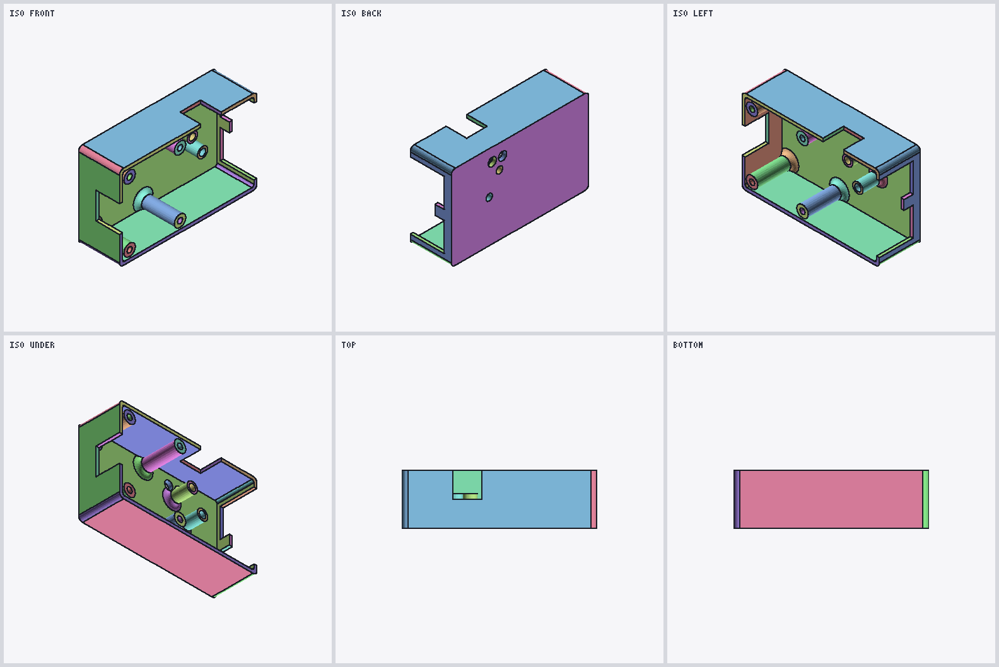
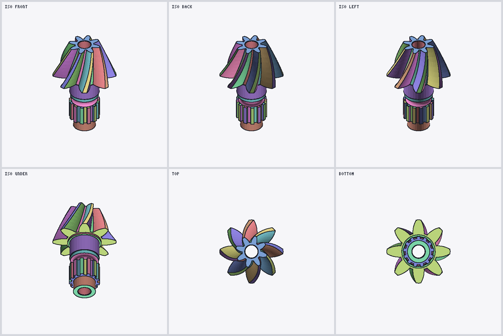

# 2. The display mesh (DisplayLists)

`Contents/DisplayLists` (modern) and `DisplayLists__ZLB` (SolidWorks 2011) hold the triangle mesh
SolidWorks drew the part with. There's one record per B-rep face, followed by a record describing
that face's surface. Both containers and every DisplayLists version seen so far (3800–19000,
[page 1](1-container.md#displaylists-version)) use the same per-face grammar.

All integers are little-endian `u32`. Coordinates are `float32` in **metres**, and surface
parameters are `float64`. The reference reader is [`display.js`][display.js].

From this stream you get the exact display triangles with their normals, which triangle edges lie
on a face boundary and which B-rep edge each one belongs to, an analytic bounding box per face,
and the surface type of each face, with its parameters for planes, cylinders and cones. You don't
get exact curved geometry. The mesh only approximates curved surfaces, so for exact geometry follow
the face ID to the Parasolid body ([page 3](3-parasolid-body.md)).



*USB hub case top: 68 faces read straight from DisplayLists. The black lines are the Block1
boundary edges. Render of a third-party part, not covered by this repo's license (see [NOTICE](../NOTICE)).*

## Typed arrays

Every array in the record starts with a 16-byte header `[stride, kind, 2, count]`, followed by
`stride × count` bytes. These combinations show up:

| header | element |
|---|---|
| `[4, 8, 2, n]` | u32 |
| `[1, 8, 2, n]` | u8 |
| `[12, 100, 2, n]` | float32 × 3 |
| `[4, 100, 2, n]` | float32 |
| `[8, 100, 2, n]` | 8-byte elements (only in the surface record, kept raw) |

The third word is always `2`. "Kind" and "stride" are just names for what was measured. They
aren't a claim about SolidWorks' own type system.

## Face record

The stream starts with `u32 [1, 1]`. To find face records, scan for the strip-length header
`[4, 8, 2, S]` and read forward. Every check below has to pass, or the candidate gets rejected and
reported. Nothing is patched up.

| order | header | body | name |
|---|---|---|---|
| 1 | `[4, 8, 2, S]` | `u32[S]` = L | strip lengths |
| 2 | `[12, 100, 2, V]` | `float32[V][3]` | positions |
| 3 | `[12, 100, 2, V]` | `float32[V][3]` | normals, unit length |
| 4 | `[4, 8, 2, N]` | `u32[N]` | Block1: edge annotations |
| 5 | `[4, 8, 2, S]` | `u32[S]` | Block2: Block1 section lengths |
| 6 | `[1, 8, 2, N]` | `u8[N]` | Block3 |
| 7 | none | 132 bytes | bounding record |
| 8 | none | variable | surface record (modern only) |

`S` is the number of strips, `L[i]` the vertices in strip `i`, `V` the vertices and `N` the Block1
words. These hold with no exception on 11,515 strips in 45 modern files:

```
V     = sum(L)            every L[i] >= 3
B2[i] = 2·L[i] − 2
N     = sum(B2) = 2·(V − S)
```

**Block2 tells you nothing new.** The strip lengths fully decide it ([EXP-061][exp061]). It's the
table of Block1 section lengths.

**Block3** has one byte per Block1 word. In the original corpus every byte is zero, but the online
sample has 30,713 nonzero ones in 27 files, all 1, 2 or 4. Where a byte sits decides what it means
([EXP-088][exp088], [EXP-109][exp109]):

| Block1 position | byte 1 | byte 2 | byte 4 |
|---|---:|---:|---:|
| a strip's control word | 2,690 (first strips only) | 0 | 16,455 (later strips only) |
| a nonzero edge label | 11,322 | 246 | 0 |
| a zero edge label | 0 | 0 | 0 |

- On an edge label, 1 marks a smooth edge use. All 371 edges with 1 on both sides and all 102 with
  1 on one side are smooth within 0.001 rad. It belongs to the face's use of the edge: where a
  plane meets a cylinder, only the curved side carries it. Not every tangent edge gets it: 12 tangent
  edges carry 0 on both sides, and all 12 touch a B-spline face.
- On an edge label, 2 marks an open boundary: 66 mesh segments on the 6 joined native edges that
  have one face, and no edge with two faces.
- On the first strip, 1 is a per-face flag. It is set on exactly the 2,690 faces that have any
  nonzero Block3 byte, 852 of which have no edge byte at all. On those faces the later strips carry
  4 throughout or 0 throughout, the same choice across a file, and 0 only below DisplayLists
  version 17000. What 4 means against 0 isn't known: winding, strip restarts and degenerate
  triangles don't separate them.

This page used to say every Block3 byte was zero and its purpose unknown. That was true only of the
original corpus (corrected 2026-11-23). Both experiments were blind-checked. The reference reader
still warns on nonzero bytes, since the strip-control bytes aren't fully decoded.

### Triangles

Each strip is an ordinary triangle strip over its own vertices. With vertex base `v` and strip
length `n`:

```
i = 2, 4, 6, …   triangle (v+i−2, v+i−1, v+i)
i = 3, 5, 7, …   triangle (v+i−1, v+i−2, v+i)
```

Reset the base and the winding at every strip. Don't join strips together and don't fan out from
the first vertex. All 50,976 strip triangles in the original corpus agree with the stored normals,
and reading them as fans fails on the controlled models.

A strip is just a unit of the tessellation. A face with a hole can be twelve strips and two
boundary cycles, and Dekor's big faces have 121 boundary cycles each. The strip count isn't a loop
count.

### Block1: which edges are face boundaries

Each strip's section is one control word (`1` on every strip in the modern corpus), then one word
per strip edge, in this order:

```
ID(0,1),
ID(0,2), ID(1,2),
ID(1,3), ID(2,3),
ID(2,4), ID(3,4), …
```

Each new vertex adds two edges, so a strip of `n` vertices has `2n − 3` edges. With the control
word, its section is `2n − 2` words long, which is its Block2 entry.

- `0` means the edge is inside the face (a triangulation diagonal).
- Anything else means the edge is on the face boundary, and **the value is the Parasolid `node_id`
  of the B-rep edge it lies on**. Every nonzero ID in a part is shared by exactly two faces.

Measured: 41,010 boundary annotations are all nonzero and 71,037 interior ones are all zero. If you
shuffle the edge order inside each strip but keep the values, you get 44,640 exceptions, so the
order above really matters ([EXP-049][exp049]). The words are `u32`. Read as `float32`, all 162,018
of them come out below 1e-30.

Use Block2's lengths to split the sections. Don't treat every `1` as a separator, because nothing
says an edge ID can't be 1.

**A split line leaves the neighbour's Block1 alone.** C18 is a cube with a line across its top at
y = 0.005, built in both the SW2011 and SW2022 sets. The side face at y = 0 keeps its four
vertices, four edge IDs, strip length and raw Block1 while its top neighbour changes from face 1
to a new face (143 in SW2011, 148 in SW2022). That side's Block1 stays `1,7,76,0,77,53` (SW2011,
face 83) and `1,9,81,0,82,58` (SW2022, face 88). The two sides at x gain a midpoint and one edge
ID, and their Block1 grows from six words to eight. So Block1 lists the face's own edge IDs and
never names a neighbour. The shared top edge kept its ID, which is why nothing changed, and C18
can't show what happens when the shared edge itself changes. The SW2011 face IDs come from the
converter's package linker, not from raw bytes. Every number was reproduced from raw bytes by a
blind check ([EXP-090][exp090], [EXP-097][exp097]).



*Helical bevel gear, 113 faces. The gaps between the teeth are real geometry, not missing faces.
All 32 open edges in this mesh run along another open edge, which is the sampling effect described
next. Render of a third-party part, not covered by this repo's license (see [NOTICE](../NOTICE)).*

### Boundary cycles

Take only the edges with a nonzero ID and join vertices whose coordinates are exactly equal. On
every face of the original corpus, that gives a graph where every vertex has two neighbours. In the
online sample it doesn't on 300 faces: an edge used twice by the face (a seam, or a slit on a plane)
or a closed edge that starts and ends at one vertex, so the loop passes it twice, gives vertices with
three or four neighbours. The reader walks
those faces through their triangles instead: each boundary segment is a cut, and at a vertex the two
boundary segments that frame the same fan of triangles are consecutive. A seam is walked once on
each side. That resolves all 159 such faces in modern files and gives identical cycles on the
20,788 faces the simple rule handles, and a blind check found the loops equal the native B-rep's
([EXP-115][exp115]). Chainwheel's 141 faces failed for another reason: in a control-0 strip the
first two edge ids come swapped, (v,v+2) before (v,v+1). Read that way, all 189 of its faces close
([EXP-117][exp117]). Its loops are
the face's boundary cycles (1,698 cycles on 1,272 faces). They're display polylines: the reference
reader doesn't decide which one is the outer boundary, and it doesn't weld vertices.

Two neighbouring faces can sample their shared edge differently. 389 of 3,278 shared edge IDs have
different vertices on the two sides, and they always lie on the same line (the biggest offset
measured is 8.3e-9 m). So welding by exact coordinates leaves some open edges on curved models
even though nothing is missing. The 13 controlled cubes close up under exact matching.

## Bounding record (132 bytes)

Right after Block3, in both containers:

| offset | type | field |
|---|---|---|
| +0 | u32 × 3 | `0, 0, 1` on all 13,589 modern face records in 118 files whose metadata parses. Meaning unknown |
| +12 | float64 × 3 | centre |
| +36 | float64 × 3 | maximum corner |
| +60 | float64 × 3 | minimum corner |
| +84 | float64 | radius: the distance from the centre to a corner |
| +92 | 40 bytes | [tail](#the-tail-of-the-bounding-record), partly decoded |

Two other layouts exist ([EXP-110][exp110], [EXP-099][exp099], blind-checked):

- A 140-byte record with an extra float64 at +92 equal to twice the radius, the rest moved by 8:
  190 faces in 3 files.
- SolidWorks 2025 and 2026 saves: +128 is 0, and the surface record's step 1 (the `[8, 100, 2, K]`
  array) is missing, so the `1` of step 2 comes right after the record and the id/tag block sits 16
  bytes earlier: 4,432 faces in 18 files.

The reference reader tells the three apart by structure, not by version (one 2025 save is all
132-byte layout). In the 2025/2026 layout the id/tag block is there, 16 bytes earlier: the reader
gets 4,484 faces in 24 files from it, and all join a native face of the matching surface type
([EXP-116][exp116]). The 140-byte layout has no id or tag: after two empty arrays and a zero flag,
the record ends with three nonzero words.

On every face the centre is exactly halfway between the corners and the radius is exactly the
corner distance (to under 1e-12), and `min ≤ max` on 1,461 of 1,461 modern and 145 of 145 legacy
records.

This is the face's **analytic** box, not the box of its mesh. It contains the mesh and almost never
equals it. Put together over a whole part, the boxes match the STEP geometry to within 1 nm on 23
of the 24 modern controlled models. The odd one out is the spline loft C16, which is padded by
about 10.4 µm on every side, so spline boxes aren't guaranteed to be tight
([EXP-061][exp061], [EXP-063][exp063], [EXP-064][exp064]).

The same layout turns up once more in most streams from version 13000 on, as the
[configuration envelope](#configuration-envelope).

Earlier versions of this table said `0, 0, 1` on 1,414 faces, and EXP-092 first reported several
leading patterns. Those came from arithmetic matches that weren't face records. With the restriction
to records whose following metadata parses, the head is `0, 0, 1` on 13,589 of 13,589
([EXP-092][exp092], [EXP-097][exp097]). They are constants in this sample, not face counts.

### The tail of the bounding record

In the 132-byte layout, the 40 bytes at +92 to +131 are ([EXP-110][exp110], blind-checked):

| offset | what |
|---|---|
| +92 | 1 on a plane, 0 on every other surface (0 mismatches on 18,808 faces joined to the native body) |
| +96 | 0 or 1, mostly the same for a whole file; meaning not found |
| +100 | per face. The low 16 bits group faces by the feature that made or trimmed them; the high 16 bits change with every save. 999,999 on every face in 11 files |
| +104, +108 | both 1 when a normal cone is stored |
| +112 | float32 s, the cone's cosine |
| +116 | float32 × 3, the cone's unit axis v |
| +128 | 1 up to DisplayLists 17000; 0 in SolidWorks 2025 and 2026 saves |

**The normal cone.** v points to the outward side of the face, so it follows the face's sense (on a
reversed cylinder it points toward the axis). s runs from 0.70837 to 0.999997, so the half-angle
stays under 45 degrees. s is never below the cosine of the widest angle between a stored vertex
normal and v, but usually above it: on most faces some normals fall outside the cone. On the 90
degree fillet of C03 and C12 the half-arc is 45.000 degrees and the stored half-angle 40.455. How
SolidWorks computes s isn't known. A file stores a cone on every non-planar face narrow enough, or
on none; no file mixes the two, and what decides it isn't known. Planes never get one. Without both
flags the floats at +112 are leftover data.

The +100 reading comes from the controlled models: on C04 the hole and the two planes it passes
through share low bits 0x006f and the other four planes 0x0068, and the fillets, chamfer, shell
and split line follow the same pattern. It isn't checked against feature IDs yet.

This section used to call +92 to +128 five binary words and the vector unexplained (corrected
2026-11-23).

### Configuration envelope

From DisplayLists version 13000 on, a stream usually holds one more record in the bounding-record
layout: the box around every saved face. It sits at the configuration's name, an MFC UTF-16
string (`ff fe ff`, a length, UTF-16LE units). The 132-byte record starts 8 bytes before the end
of that string. Find it by that name relationship. Arithmetic alone isn't enough: unnamed boxes
with the same arithmetic turn up in Dekor, the helical gear, `J6_Flange_Adapter`, `CR26-201-08`
and eight files with no named record, and none of them equals the face union.

Blind-checked ([EXP-091][exp091], [EXP-093][exp093], [EXP-097][exp097]):

- 113 of 166 readable modern files have a named record. In 112 of them it equals the union of the
  saved per-face boxes, to within 1.1e-16 m.
- It starts at version 13000: none in the 42 files at 12000 or below, and 113 of 124 files from
  13000 on. The declared version belongs to the release that last wrote the stream
  ([page 1](1-container.md#displaylists-version)), so a recent file can lack it.
- Of the 11 files from 13000 on without it, 3 have no faces. The other 8 all have LocalBodies or
  several configuration IDs, but 15 of 21 files with LocalBodies, and one with several
  configuration IDs, keep it. Re-saving doesn't decide it either: 3 of the 8 were saved by one
  release only, and 34 files saved by several releases keep the record. No tested property
  explains the omissions.
- `ac760485_存矿小端` is the exception: its record reaches 4.412 mm past the face union in −x and
  12.684 mm in +z. The cause isn't known. Nothing readable in the file reaches that box. It has 11
  framed Parasolid sections and 10 parse: the active 38-face body, a ghost partition with two
  points at the origin, and eight one-face support snapshots. Their combined point box, and a
  sample of every decoded edge (147,600 points, 1,025 parameters per edge), both stop at the display
  box. The eleventh section is the partition's delta program, not an independent body. The sampling
  is corroboration, not proof. A stale envelope, sketch or reference geometry, or another
  display-level object would all fit ([EXP-092][exp092]).
- By version, the files with the record are 0 of 42 at 3800 to 12000, 8 of 8 at 13000, 5 of 5 at
  14000 and 100 of 111 at 15000 to 19000. By structure (13000 and later, with faces): 97 of 97 with
  one configuration ID and no LocalBodies, 15 of 21 with one ID and LocalBodies, 1 of 2 with
  several IDs and no LocalBodies, 0 of 1 with several IDs and LocalBodies. Five of the 42 older
  files have an arithmetic box match with no name relationship, so arithmetic shape alone isn't a
  signature ([EXP-093][exp093]).

Earlier this page said the layout turns up once per configuration in 45 of 45 modern files
([EXP-064][exp064]). That count took the nameless look-alikes in Dekor and the gear for second
configurations. Each of those files has one named record ([EXP-091][exp091]). What the box is
used for is still unknown.

## Surface record (modern only)

It starts 132 bytes after Block3, right after the bounding record. Read it forward:

| step | content |
|---|---|
| 1 | typed array `[8, 100, 2, K]`. Empty except on eight distributor faces (K = 50, 54), kept raw |
| 2 | `u32`, `1` everywhere in the corpus |
| 3 | typed array `[12, 100, 2, A]`, empty everywhere in the corpus |
| 4 | typed array `[12, 100, 2, B]`, empty everywhere in the corpus |
| 5 | `u32 scalarFlag`: `0`, or `1` followed by two `[4, 100, 2, V]` float32 arrays with one value per vertex |
| 6 | `u32 × 3`, zero in 13,533 of 13,533 records that have steps 7–11. [Nonzero ones](#records-with-no-id-or-tag-block) have none of them |
| 7 | `u32` **face ID**, which is the Parasolid FACE `node_id` |
| 8 | `float64 × 3` direction |
| 9 | `u32` **surface type tag** |
| 10 | `float64 × 8` parameters |
| 11 | `u32` edge count, then that many `(u32 edge ID, u32 edge type tag)` pairs |

Don't read the tag at a fixed offset. The arrays in steps 1, 3, 4 and 5 can be empty or not, and
that moves it.

**The edge table.** Its set of IDs equals the face's nonzero Block1 IDs, and also equals the set of
Parasolid edges around the face. The reference reader refuses a filled-in table that disagrees with
Block1. There's one known exception: a part saved in SolidWorks 2011 and saved again in 2022 (C23)
has an **empty** table on every face, while Block1 still has the IDs.

**The edge type tag** is the native edge's curve class ([EXP-108][exp108]). A file uses one of two
forms, set by its DisplayLists version: `3000 + class` up to 15000, and `48000 + 16 × class + j`
from 16000. No file mixes them.

| class | 1 | 2 | 3 | 4 | 5 | 6 |
|---|---|---|---|---|---|---|
| curve | line | circle | ellipse | intersection | B-spline | SP_CURVE |

A trimmed curve counts as its basis curve. In the 480xx form, `j` says how the edge is shared: 2 is
an edge with one fin (966 of 966), 1 a tangent edge, 0 a sharp one, and -1 a variant that fills two
whole files (`a4ecc6f5` and `PTC GE8080-8`) with smooth and sharp edges alike. Seams, where both fins
are on one face, come out as `j` = 1. Convexity isn't encoded: both convex and concave edges occur
in the thousands under 3001 and 48016.

A blind check found 0 class mismatches over 34,876 edges joined by display ID. Joined by mesh
endpoints instead, 32 of about 52,000 rows disagree, all on IDs shared by two or three native edges, so "no
exceptions" depends on the join. 28 files at versions 16000 to 19000 have no edge numbers at all.
What follows the edge table is only partly read: it starts with a persistent-id string for the face
(for example `moSimpleSurfIdRep_c,N,N,`), and the objects after it aren't decoded.

**The optional per-vertex arrays.** The two float32 arrays from step 5 are per-vertex surface
parameters, conventionally (u, v). They occur on 1,545 faces and 205,327 vertices in 37 files. Earlier
this page said 390 faces and described the values on four cone faces as an angle and a negative
distance; the 390 was a smaller count and the description was incomplete. Evaluated in stored order
against the exact native surface of the controlled models, with a blind check using its own
closed-form evaluators ([EXP-091][exp091], [EXP-097][exp097]):

| tag | faces | vertices | largest point error |
|---|---:|---:|---:|
| 4003 cone | 1 | 144 | 1.09e-9 m |
| 4004 sphere | 1 | 5,004 | 1.24e-9 m |
| 4006 B-surface | 4 | 1,776 | 2.29e-6 m |

The cone's second array is the signed axial distance. On the B-surfaces the saved display points
are approximate, so the error is the gap between a display point and the exact surface point at its
stored parameters. Both cone and sphere residuals are at float32 rounding.

Limits:

- Swapping the two arrays gives metres of error only on the cone. On the sphere and the loft the
  median is about 5 mm (largest 1.0 and 1.3 cm), so the order is not proven by a large swap error
  there.
- One closed periodic B-spline (`leva1`) stores u up to 2 on a knot range of [0, 1]. Wrapping by the
  period brings it to 2.4e-8 m.
- Planes, cylinders, tori, blends and tags 4008 and 4010 were not evaluated. The same arrays occur
  on tags 4007 to 4010 and on four records with an undecoded tag, but those were counted only.
- Boundary vertices sit off the surface: 9,250 of 39,529 are over 1e-7 m, up to 6.9e-4 m on a
  swept face (Dekor), against 180 of 42,630 interior vertices. The boundary ones are shared
  vertices that lie on chords ([EXP-105][exp105], [page 4](4-mesh-and-body.md#curved-faces-in-the-online-sample)).

### Surface type tags

| tag | surface | how we know |
|---|---|---|
| 4001 | plane | SolidWorks' own per-face report on the controlled models |
| 4002 | cylinder | same |
| 4003 | cone | same |
| 4004 | sphere | same |
| 4005 | torus | same. A 90° torus is still 4005, so the tag is the surface type, not the trimmed patch |
| 4006 | B-surface (spline) | same |
| 4007 | blend (Parasolid `BLENDED_EDGE`) | the ID link to the Parasolid body, 72 faces in 7 files ([EXP-097][exp097]) |
| 4008 | offset surface (Parasolid `OFFSET_SURF`) | the ID link, 1 of 1 face (`2f121983`). Blind check upheld ([EXP-100][exp100]) |
| 4009 | swept surface (Parasolid `SWEPT_SURF`) | the ID link to the Parasolid body, 408 faces in 6 files ([EXP-097][exp097]) |
| 4010 | spun surface (Parasolid `SPUN_SURF`) | the ID link, 288 of 290 faces in two parts (`a4ecc6f5`, `8cd79ff5`); the other 2 have no native face. Blind check upheld ([EXP-100][exp100]) |

4001–4006 agree with SolidWorks on 136 of 136 faces of the 2022 models that were built in 2022
([EXP-055][exp055]). Every tag maps to exactly one Parasolid surface type on all 1,414 modern faces
([EXP-074][exp074]). 4007 and 4009 come from real parts, not from a model built to test them. Earlier this page gave
33 faces in two parts for 4007 and 311 faces in one part for 4009; EXP-097 counted every display
face in the corpus and got the larger numbers above. Both sets of counts rest on a join by face ID,
which was later found unreliable where IDs repeat ([below](#face-ids-repeat-across-bodies)), so
treat the counts as soft. The control holds: C13 to C16 join as cone, sphere, torus and B-spline.

4008 and 4010 were found by counting the tag on every display face in the corpus, which also
turned up 56 records that have no tag at all ([EXP-097][exp097], [below](#records-with-no-id-or-tag-block)).
A blind check joined the faces to the body by ID and upheld both names: 284 of 286 faces of
`a4ecc6f5` and 4 of 4 of `8cd79ff5` join a spun surface, and the one 4008 face joins an offset
surface ([EXP-100][exp100]). Mesh vertices sit on the joined surface at a mean of 6e-6 m, 3e-7 m
and 1.0e-5 m (the 4008 face). That is as close as the cylinder and cone controls, so the distance
by itself can't tell a spun face from a cylinder, and the names rest on the ID join.

### Surface parameters

Checked against STEP geometry exported separately:

| tag | direction | parameters |
|---|---|---|
| 4001 plane | the plane normal, up to sign | **not** an origin: all eight are zero, even on faces that are moved away from it |
| 4002 cylinder | the axis | slots 0–2 a point on the axis, slot 6 the radius |
| 4003 cone | the axis | slots 0–2 a point on the axis, slot 6 the radius there, slot 7 the half-angle in radians. Apex = point + axis · radius / tan(angle) |

The other tags' parameters are kept raw. 4010 records carry no axis in them: all eight parameters
are 0 on 290 of 290 faces. Their display `direction` is parallel to the axis on 260 faces and
perpendicular on 28, so it isn't the axis either ([EXP-100][exp100]). For exact geometry of any
face, follow its face ID to the Parasolid body.

### Records with no id or tag block

Some modern display records have no face ID, direction, tag or parameters. The three words at step 6
tell them apart: zero on every record with an id/tag block (13,533 of 13,533) and nonzero on every
record without one (994 records in 21 parts, none with a valid tag). Two blind checks hold this both
ways ([EXP-099][exp099]).

In three parts every record lacks the block: 342 in `0739c559`, 62 in `7765d286` and 6 in
`eefa906d`. Read at the usual offset, some give "tags" that are bytes of other data: 4980815 (UTF-16
"OL" from `SOLIDWORKS Materials|ABS|33`) on 33 faces, 16368 (the high half of a float64 1.0 in a
colour block) on 23, and 65536 on 1. Most of the 994 are short records with a 44-byte tail and no
appearance text, where the "tag" is bytes of the next record. Six in `14f9214b` and `a0ab30c8` have
words 1, 96, 2 and a 3 KB tail, not decoded.

This section first said 56 records in 3 parts, 22 of them in `7765d286`. Those were only the records
whose misread tag looked odd (corrected 2026-11-23).

A reader should refuse the ID and tag when any of the three words is nonzero, and keep the mesh. The
reference reader does. These records aren't the faces in the
[2025/2026 layout](#bounding-record-132-bytes), which have their id/tag block 16 bytes earlier.

### Face IDs repeat across bodies

A face ID is unique within one body, not within the part. In 9 parts, 552 groups of display faces
share an ID, and in all 552 the members are in different bodies, never in the same one. In
`2f121983`, ID 253 is a cylinder in body 2 and a plane in body 8 of one partition. A periodic face
split in two would put both halves in one body, so that doesn't explain it. Measured by one
agent ([EXP-099][exp099]), not blind-checked.

A LocalBodies section numbers its own node_ids from 1 ([page 3](3-parasolid-body.md#localbodies-entries)),
and the display keeps those section-local numbers. In 6 parts, 3,880 of 13,532 display faces match
a native face only after undoing the renumbering a reader applies when it puts sections together
(`d2515121` alone has 2,349); 148 faces in four parts match neither way. So a join by ID alone can
land on the wrong face. A reader has to keep each section's own ids and narrow repeated ones by
surface type, then by geometry. Done that way, 13,375 of 13,533 display faces join; a blind check
contradicted 3 of those joins, by 8 to 22 µm, and couldn't separate candidates that share id, type
and edge ids ([EXP-104][exp104], [EXP-107][exp107]). The reference reader does this on `dev`.

### Ids that don't match the body (two 2013 files)

In `f666f342` (head_face, SolidWorks 2013) the display's edge ids equal the body's node ids up to
9087, are one lower from 9542 to 9602 and one higher from 10898, over the same 1,810 edges. The
shifts fall in id ranges with no edge. The legacy record's face id, the u32 at offset 82 of its
96-byte tail, is shifted the same way. head_back (2013) shifts by 0 to −44, and its mesh isn't the
same geometry as its body. Other 2013 and 2014 files don't shift. Both numbers are read from their
own fields, so a join by id alone can be off by one here. Blind-checked ([EXP-118][exp118]); where
the shift comes from isn't known.

The same file has the only two display faces in the corpus whose mesh boundary carries no edge id
(faces 75 and 448). Their body faces have a loop that doesn't go round the bore, so SolidWorks'
mesh stops at an edge that isn't in the body ([EXP-118][exp118]).

## The stream is rewritten on any change

Don't plan to cache face offsets and patch one face. When a face is added or changed, every face
after it moves in the stream, and the byte diff between files built one feature apart is mostly
reshuffling, not the new face's own bytes ([EXP-028][exp028]). A change cannot be localized in
the binary; readers parse the stream as a whole, every time.

## Cosmetic threads

A cosmetic thread gets a record of its own: a closed band around the hole or shaft at about the
thread's minor diameter, drawn over the real face. It starts like a face record, with strip
lengths, points and normals: two strips of 50 points, 100 points in all in every case so far.
Then comes u32 1 where Block1's array header would be. It isn't a face, so the band doesn't count
toward the face total, and it doesn't belong in an STL.

Seen in three online parts, with 2, 4 and 1 bands (radius 4.25 mm × 25 mm, 1.65 × 10, 5.1 × 15).
Each part's Parasolid body has exactly that many VECTOR_VALUES nodes, and no other part has any,
so the thread is stored on the body side too ([EXP-084][exp084]). The rest of the band record
hasn't been decoded; one of them is followed by the strings "Thread" and "Steel".

## Parts saved without display data

A part can be saved without its mesh. Then either there's no DisplayLists stream at all, or there
is one that holds only lights and view settings. Two such streams from different parts were the
same 12,979 bytes, with the default bounding box −1 to 1.

You can tell them apart by class name. A stream with a mesh has `uoTempBodyTessData_c` and
`uoTempFaceTessData_c` in it, and one without a mesh doesn't. Across the 125 modern files in the
online sample that rule has no exceptions: 108 have the class and faces, 5 have a DisplayLists
stream without it and no faces, and 12 have no DisplayLists ([EXP-084][exp084]).

The mesh isn't somewhere else either. Every stream of those 17 parts was searched for the
tessellation classes and for runs of float32 unit vectors, which a mesh has thousands of. None has
the classes, and the few unit vectors there are all belong to something else: standard view
rotations (`moView_c`), light directions, colours and feature data ([EXP-085][exp085]). Four of the
five view-only streams were carried over from an older save. For these parts, a mesh has to come
from triangulating the Parasolid body.

## SolidWorks 2011

The 25 SolidWorks 2011 models use the same face record and bounding record. Their geometry was
checked against the sizes chosen before the models were built (7 of 7 boxes), against the matching
2022 models (22 of 22 boxes) and against their own bounding records (145 of 145)
([EXP-066][exp066]).

What comes after the bounding record has a different grammar that hasn't been decoded. The
reference reader hands those bytes back raw. That means 2011 faces have no surface record, so no
face ID or surface tag from the mesh side. The Parasolid body in the same file still has both, and
the mesh joins it through the edge IDs ([page 4](4-mesh-and-body.md)).

Files older than 2011 have two more variants of this record. They're on [page 5](5-pre-2011.md#the-mesh).

[display.js]: https://github.com/blussyya/solidworks-converters/blob/main/src/display.js
[exp049]: https://github.com/blussyya/sldprt-research-dump/blob/main/knowledge/evidence/2026-09-15_v0.4.8-EXP049.md
[exp055]: https://github.com/blussyya/sldprt-research-dump/blob/main/knowledge/evidence/2026-09-21_tag-identification-EXP055.md
[exp061]: https://github.com/blussyya/sldprt-research-dump/blob/main/knowledge/evidence/2026-09-21_v0.4.9-EXP061.md
[exp063]: https://github.com/blussyya/sldprt-research-dump/blob/main/knowledge/evidence/2026-09-21_v0.4.9-EXP063.md
[exp066]: https://github.com/blussyya/sldprt-research-dump/blob/main/knowledge/evidence/2026-09-22_v0.5-EXP066.md
[exp064]: https://github.com/blussyya/sldprt-research-dump/blob/main/knowledge/evidence/2026-09-21_v0.4.9-EXP064.md
[exp028]: https://github.com/blussyya/sldprt-research-dump/blob/main/knowledge/evidence/2026-08-14_v0.4.7-EXP028.md
[exp074]: https://github.com/blussyya/sldprt-research-dump/blob/main/knowledge/evidence/2026-09-29_v0.4.9-EXP074.md
[exp084]: https://github.com/blussyya/sldprt-research-dump/blob/main/knowledge/evidence/2026-10-27_v0.5-EXP084.md
[exp085]: https://github.com/blussyya/sldprt-research-dump/blob/main/knowledge/evidence/2026-10-28_v0.5-EXP085.md
[exp090]: https://github.com/blussyya/sldprt-research-dump/blob/main/knowledge/evidence/2026-11-05_v0.5-EXP090.md
[exp091]: https://github.com/blussyya/sldprt-research-dump/blob/main/knowledge/evidence/2026-11-05_v0.5-EXP091.md
[exp092]: https://github.com/blussyya/sldprt-research-dump/blob/main/knowledge/evidence/2026-11-05_v0.5-EXP092.md
[exp093]: https://github.com/blussyya/sldprt-research-dump/blob/main/knowledge/evidence/2026-11-05_v0.5-EXP093.md
[exp097]: https://github.com/blussyya/sldprt-research-dump/blob/main/knowledge/evidence/2026-11-06_v0.5-EXP097.md
[exp099]: https://github.com/blussyya/sldprt-research-dump/blob/main/knowledge/evidence/2026-11-09_v0.5-EXP099.md
[exp100]: https://github.com/blussyya/sldprt-research-dump/blob/main/knowledge/evidence/2026-11-09_v0.5-EXP100.md
[exp104]: https://github.com/blussyya/sldprt-research-dump/blob/main/knowledge/evidence/2026-11-09_v0.5-EXP104.md
[exp105]: https://github.com/blussyya/sldprt-research-dump/blob/main/knowledge/evidence/2026-11-09_v0.5-EXP105.md
[exp107]: https://github.com/blussyya/sldprt-research-dump/blob/main/knowledge/evidence/2026-11-09_v0.5-EXP107.md
[exp088]: https://github.com/blussyya/sldprt-research-dump/blob/main/knowledge/evidence/2026-11-05_v0.5-EXP088.md
[exp108]: https://github.com/blussyya/sldprt-research-dump/blob/main/knowledge/evidence/2026-11-09_v0.5-EXP108.md
[exp109]: https://github.com/blussyya/sldprt-research-dump/blob/main/knowledge/evidence/2026-11-09_v0.5-EXP109.md
[exp110]: https://github.com/blussyya/sldprt-research-dump/blob/main/knowledge/evidence/2026-11-09_v0.5-EXP110.md
[exp115]: https://github.com/blussyya/sldprt-research-dump/blob/main/knowledge/evidence/2026-11-24_v0.5-EXP115.md
[exp116]: https://github.com/blussyya/sldprt-research-dump/blob/main/knowledge/evidence/2026-11-24_v0.5-EXP116.md
[exp117]: https://github.com/blussyya/sldprt-research-dump/blob/main/knowledge/evidence/2026-11-24_v0.5-EXP117.md
[exp118]: https://github.com/blussyya/sldprt-research-dump/blob/main/knowledge/evidence/2026-11-26_v0.5-EXP118.md
