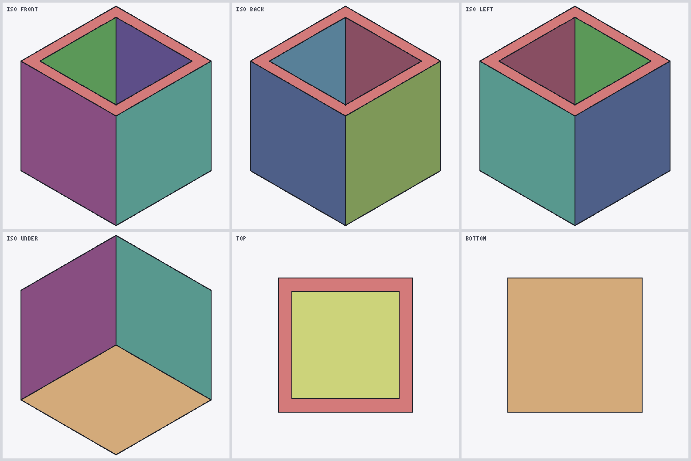
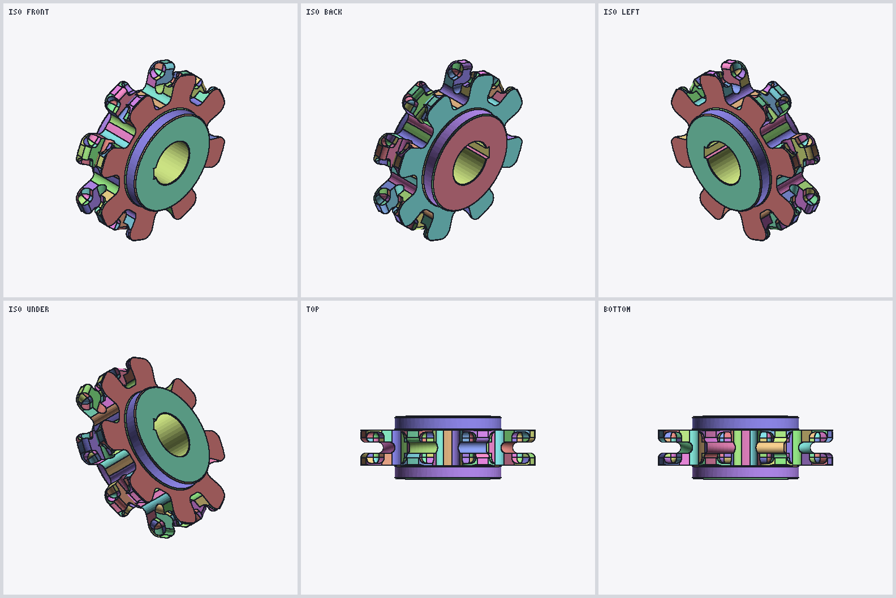
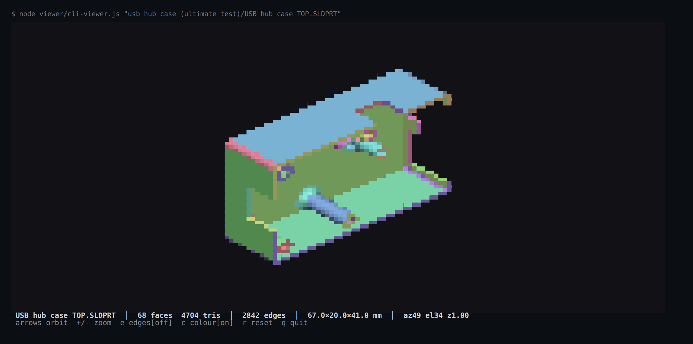

# Using the code

Everything in these docs has a reference implementation in [solidworks-converters][code]. It's a
Node.js package and command-line tool (`sldprt`) with no dependencies, it needs Node 18 or newer,
and it's licensed Apache-2.0. This page is a quick tour. The code repository is the place to go
for anything beyond it.

```sh
git clone https://github.com/blussyya/solidworks-converters
cd solidworks-converters
node bin/sldprt.js info samples/sw2022/C04_cube_hole_5mm.SLDPRT
```

```
container   modern (SolidWorks 2015+), 62408 bytes
DisplayLists version 15000
streams     38
display     7 faces, 152 triangles (modern DisplayLists)
surface tags 4001×6  4002×1
partition   Contents/Config-0-GhostPartition: partition (complete)
partition   Contents/Config-0-Partition: partition + deltas (complete)
B-rep       186 nodes from Contents/Config-0-Partition: 1 body, 2 shell, 7 face, 10 loop, 14 edge, 8 vertex
surfaces    plane×6  cylinder×1
graph checks 367 run, 0 failed
```

There's nothing to `npm install`. Run `npm link` once if you want a `sldprt` command.

## Commands

| command | what it does |
|---|---|
| `sldprt info part.SLDPRT` | shows what's in the file |
| `sldprt parse part.SLDPRT > mesh.json` | dumps the mesh and surface records as JSON |
| `sldprt convert part.SLDPRT --stl out.stl --step out.step` | exports. STEP is exact by default. `--mesh` writes it from the display mesh (planes exact, the rest triangles) and `--faceted` makes every face triangles. Also `--ascii` and `--scale N` |
| `sldprt brep part.SLDPRT` | the Parasolid body: node counts and graph checks (`--json`, `--nodes`, `--volume`) |
| `sldprt render part.SLDPRT sheet.png` | six views of the part in one PNG |
| `sldprt view part.SLDPRT` | spins the part around in your terminal |
| `sldprt serve --open` | a viewer in the browser. Files are parsed on your machine and never uploaded |



*A SolidWorks 2011 part, a cube shelled to 1 mm, read straight out of its legacy DisplayLists
stream. The black lines are the edges the file marks as face boundaries.*



*Pocket Wheel: 400 faces, 17,078 triangles, exactly as the parser read them. Nothing welded or
patched. Render of a third-party part, not covered by this repo's license (see [NOTICE](NOTICE)).*



*`sldprt view` on USB hub case TOP. Render of a third-party part, not covered by this repo's license (see [NOTICE](NOTICE)).*

## From JavaScript

```js
const sldprt = require('sldprt');   // or require('./src') from a clone
```

Every function takes a file path, a `Buffer`, a `Uint8Array` or an `ArrayBuffer`.

### `parse(file)`: the display mesh

It never throws on a bad file. Problems end up in `errors`, `rejected` and `warnings`.

```js
{
  format: 'modern DisplayLists' | 'legacy OLE2 DisplayLists',
  displayListsLength, stream,
  errors: [],          // not empty: nothing usable was read
  rejected: [],        // face records that failed a check: the output is partial
  partial: false,
  warnings: [],        // e.g. an empty edge table
  stats: { faces, triangles, metadataFaces },
  faces: [ face, … ]
}
```

A face:

| field | meaning |
|---|---|
| `vertexCount` | number of vertices |
| `vertices`, `normals` | `Float32Array`, xyz per vertex, metres |
| `triangleIndices` | `Uint32Array`, triples into the face's vertices |
| `stripLengths` | vertices per triangle strip |
| `edgeAnnotations` | per strip edge: `{strip, vertices:[a,b], id, tokenOffset}`. `id` 0 is inside the face, anything else is the Parasolid edge `node_id` |
| `boundaryCycles` | `[{vertices, edgeIds}]`, the closed boundary polylines, or `null` with `boundaryError` |
| `bounds` | `{min, max, center, radius}`, the face's analytic box (float64), or `null` |
| `metadata` | modern only, and `null` with `metadataError` if it didn't check out |
| `metadata.rawId` | the Parasolid FACE `node_id` |
| `metadata.typeTag` | 4001 plane, 4002 cylinder, 4003 cone, 4004 sphere, 4005 torus, 4006 B-surface, 4007 blend, 4009 swept |
| `metadata.direction`, `metadata.parameters` | see [surface parameters](format/2-display-mesh.md#surface-parameters) |
| `metadata.edgeRecords` | `[{id, typeTag}]`, the face's B-rep edges |
| `block1`, `block2`, `block3`, `offsets`, … | the raw arrays and byte offsets, so you can check any value against the file |
| `legacyTail` | SW2011 only: the undecoded bytes after the bounding record |
| `extraArrays` | chainwheel-style pre-2011 faces: the counts and offset of the two extra arrays before the bounding record |
| `noEdgeTable` | `true` on plate4-style pre-2011 faces, which have no Block1, Block2 or Block3 and so no edge IDs |

### `readBrep(file, {maxNodes})`: the Parasolid body

```js
{
  source: 'Contents/Config-0-Partition',   // or LocalBodies; before 2011, Config-0-Body or the configuration's stream
  kind: 'partition',
  parsed: {
    header: { schema, description, maxTypes, userfields, isBase, version, littleEndian },
    nodes: [ { type, name, index, values, pointers, start, end }, … ],
    edits,        // schema edit scripts per node type
    spans,        // every byte range and what it decoded to
    terminated, error, unresolved
  },
  graph: { checks, errors, rings }         // errors is [] when every graph check passed
}
```

`values` holds the fields by name. Pointers are node indices, so resolve them with
`new Map(parsed.nodes.map(n => [n.index, n]))`. It throws if the file has no body at all, which
happens for a part with no solid.

`parsed.header` also says which kind of transmit file was read: `isBase` is `true` when the file
is written in schema 13006 or 9008 itself with no edit scripts, `version` is the base schema, and
`littleEndian` is `true` for a Parasolid 9 bare binary file ([page 5](format/5-pre-2011.md#the-parasolid-body)).

### `info(file)`: a summary

Container type, stream names and sizes, DisplayLists version, mesh counts and surface tags,
partition sections, the body's node counts and graph-check totals. It's what `sldprt info --json`
prints.

### Export

```js
sldprt.toSTL(file)                        // Buffer, binary STL in millimetres
sldprt.toSTL(file, { ascii: true })       // string
sldprt.toSTEP(file)                       // { text, report }: exact AP214 from the Parasolid body
sldprt.toSTEP(file, { mode: 'mesh' })     // from the display mesh: planes exact, the rest triangles
sldprt.toSTEP(file, { mode: 'faceted' })  // every face as triangles
sldprt.volume(file)                       // { volume (m³), faces, unsupported }
```

STL comes from the display mesh. A part saved without one (no DisplayLists, or one with no
tessellation in it) gets its STL from the Parasolid body instead, triangulated so every triangle
is within `tolerance` of the exact surface (metres, 1e-5 by default). `sldprt.meshModel(file).source`
says which one you got. The triangulation is new: across the online sample it gives a closed mesh
on 80 of 136 parts and fails or leaves gaps on the rest ([EXP-084][exp084], section 8).

Exact STEP throws if the body uses something it can't
write yet (see [what isn't done](export/exact-step.md#what-isnt-done)). `report.mode` says which
mode was used, and for exact STEP `report.uncertaintyMM` gives the uncertainty written into the
file. For mesh STEP and STL, `scale` (1000 by default) converts metres to the output unit.

`volume` is the [exact volume](export/exact-volume.md), with no mesh involved. For now it only
handles bodies without intersection curves, tolerant edges, swept surfaces or blends. On a body
that has them, `volume` is `undefined` and `unsupported` lists what it met, for example
`['intersection curve', 'blend']`.

### Lower-level modules

```js
sldprt.brep.model(parsed)     // the body as vertices, edges, faces, shells and bodies
sldprt.brep.volume(model)
sldprt.step.read(text)        // a STEP file back into the same model shape
sldprt.display                // parseSLDPRT(bytes, inflateRaw, inflateZlib), extractDisplayLists(bytes, legacy)
sldprt.container.modern       // decompressOpenSX, findDisplayLists, displayListsVersion, crc32, isOLE2
sldprt.container.ole          // read(bytes) -> {entries, stream(entry)}, displayLists(bytes, inflate)
sldprt.container.blast        // blast(bytes) -> {data, consumed}: PKWARE DCL implode (pre-2011 streams)
sldprt.parasolid.xt           // parse(bytes, binary, {maxNodes}), also for standalone .x_t / .x_b
sldprt.parasolid.partition    // streams, sections, extractPrimary, survey, legacyBody, readBody
sldprt.parasolid.topology     // graph checks
sldprt.convert                // loadModel(parsed), toSTLBinary, toSTLAscii, toSTEP
```

## In the browser

`src/inflate.js`, `src/container/modern.js`, `src/container/blast.js`, `src/container/ole.js` and
`src/display.js` load as plain scripts and define `SLDPRTInflate`, `SLDPRTModern`, `SLDPRTBlast`,
`SLDPRTOLE` and `SLDPRTDisplay`. `blast.js` is only needed for files older than 2011, and it has to
load before `ole.js`:

```html
<script src="src/inflate.js"></script>
<script src="src/container/modern.js"></script>
<script src="src/container/blast.js"></script>
<script src="src/container/ole.js"></script>
<script src="src/display.js"></script>
<script>
  const result = SLDPRTDisplay.parseSLDPRT(bytes, SLDPRTInflate.inflateRaw, SLDPRTInflate.inflate);
</script>
```

Exact STEP works in the browser too. Load these thirteen files in this order, as plain scripts or
with `importScripts` in a worker (that's what `web/step-worker.js` does):

```
src/inflate.js  src/container/modern.js  src/container/blast.js  src/container/ole.js
src/parasolid/xt.js  src/parasolid/partition.js  src/geom/eval.js  src/brep/native.js
src/brep/fit.js  src/brep/procedural.js  src/brep/split.js  src/step/write.js  src/step/export.js
```

```js
const body = SLDPRTPartition.readBody(bytes);          // bytes: a Uint8Array of the .SLDPRT
if (body.parsed.error) throw new Error(body.parsed.error);
const { text, report } = SLDPRTStepExport.toSTEP(body.parsed, { name: 'part' });
```

A big part takes a few seconds (Pocket Wheel, 400 faces, about 10 s), so run it in a worker. The
STL writer (`convert.js`) only runs in Node.

## Running the tests

The tests need the corpus, which lives in the dump repository:

```sh
git clone https://github.com/blussyya/sldprt-research-dump ../sldprt-research-dump
npm test
```

Without it, the tests that need the corpus show up as skipped. The OpenCascade checks also need a
Python with `cadquery-ocp`, set with `SLDPRT_OCP_PYTHON`.

[code]: https://github.com/blussyya/solidworks-converters
[exp084]: https://github.com/blussyya/sldprt-research-dump/blob/main/knowledge/evidence/2026-10-27_v0.5-EXP084.md
